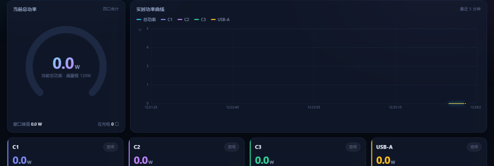

# 酷态科 10 号 Ultra · 桌面监视器

把 **CUKTECH 10 号 Ultra（AD1204U，120W 四口充电器）** 的数据搬到 Windows 桌面上：
实时功率 / 电压 / 电流、四口明细与协议协商结果、用电量账本、温湿度曲线、反向控制，
以及一个「有电压没电流就自动断电」的小功能。

> 非官方项目，与酷态科（CUKTECH）、小米均无关联。协议细节来自公开资料与自己这台设备上的实测。



## 下载

不想配环境就用便携包：[**Releases**](https://github.com/shuangshuiding-oss/cuktech-monitor/releases/latest)
里下 `酷态科10号Ultra-便携版-vX.Y.Z-自解压.exe`，双击解压即用 —— 自带 Node 与 Python 运行时，
目标机器不需要装任何东西。

想从源码跑，见下面「从源码跑」。

## 它能做什么

- **实时读数**：总功率 / 四口功率 / 电压 / 电流 / 协议（PD、PPS、UFCS、SCP…），0.5~10 秒可调采样
- **用电账本**：按天累计（度 / Wh / mAh）、充电会话、分口累计、插拔记录，可导出 CSV
- **温湿度**：外挂米家温湿度计（BLE）或本机 USB 传感器，与功率共用时间轴
- **反向控制**：四口开关、场景模式、息屏时间、屏幕语言、10 个协议开关（逐口 PD/PPS/UFCS/SCP）
- **自动断电**：某口有电压（≥5V）却几乎没有电流（≤0.02A）并持续若干秒 → 自动关掉该口
- **异常检查**：每次「有电压没电流」都留一条记录（时间 / 端口 / 峰值电压电流 / 持续多久 / 是否被自动关闭）
- **风扇**：米家直流变频风扇（miIO over LAN）的状态与档位控制

界面是深色液态玻璃风格，Electron 外壳，无边框。

## 需要什么

| 项目 | 要求 |
|---|---|
| 系统 | Windows 10 1809+ / Windows 11（用到 WinRT 的 BLE 接口） |
| 蓝牙 | **支持 BLE（4.0+）** 的适配器。台式机插 USB 蓝牙棒时注意：Wi-Fi+蓝牙组合卡（如 RTL8821CE）与 2.4G Wi-Fi 共用天线，扫得到但连不上很常见 —— 把 Wi-Fi 切到 5GHz |
| 设备 | 一台 AD1204U；手机上的米家 App 已添加过它 |
| 登录 | 一次性扫码（米家 App 授权），拿到这台设备的 BLE 密钥 |

⚠️ **同一时刻只允许一个中心端连着它**：本程序连着充电头时，手机米家就连不上（反之亦然）。
界面右上角有「让位给手机米家」按钮，可以临时释放蓝牙。

## 数据与隐私

- 所有数据都在 `data\` 下，**只在本机**，程序不上传任何东西。
- `data\cuktech.token` 是这台充电头的 **BLE 密钥**（扫码得来的），拿到它就等于能连上这台设备 ——
  别提交到仓库、别随手发人（本仓库的 `.gitignore` 已经把 `data/` 整个排除）。
- 便携包同样不含 `data\`，官方打包脚本里有隐私检查（`tools\package.ps1` 第 8 步）。
- 历史保留：原始采样 7 天、每分钟降采样 400 天、日志 2MB 轮转。

## 从源码跑

```bat
:: 1) Node 依赖（electron 外壳 + koffi）
npm install

:: 2) Python 运行环境（3.13）
python -m venv .venv
.venv\Scripts\python.exe -m pip install -r requirements.txt

:: 3) 启动（调试模式会把报错显示在窗口里）
调试启动.bat
```

不装 Electron 也能用：`node server.js` 之后浏览器开 `http://127.0.0.1:8799/`
（端口冲突会自动往后找）。

## 便携包

`tools\package.ps1` 会打出一个自带 Node + Python 运行时的免安装包
（`dist\酷态科10号Ultra-便携版-vX.Y.Z-自解压.exe`，约 119 MB），对方解压即用，
不需要装任何东西。构建产物不进仓库，发在 Releases 里。

## 测试

这个项目的自检比代码还长，理由写在 `tools/check_all.ps1` 顶部：蓝牙和窗口这类东西
没法靠眼睛验证，就把"必须是这样"写成可判定的断言。

```bat
powershell -ExecutionPolicy Bypass -File tools\check_all.ps1
```

覆盖：语法 / 行尾（代码 LF、文档 CRLF）/ BLE 会话层乱序与重传 / 曲线抽稀与去重 /
证书体检的定性（缺根 vs 中间人）/ 自动断电判定与空账 / 打包路径一致性 / 界面布局规则 …
当前约 900 项断言。

## 已知限制

- 蓝牙侧 **读不到充电头内部温度**（属性不存在），温度只能靠外挂传感器，或看它自己的屏幕
- 同一时刻只能一个中心端连接（见上），所以手机米家与本程序互斥
- 只在 AD1204U 上验证过；同系列其他型号的属性表可能不同

## 许可证

MIT，见 [LICENSE](LICENSE)。第三方代码与资料的出处见 [THIRD_PARTY_NOTICES.md](THIRD_PARTY_NOTICES.md)。

---

`使用说明.txt` 是发给最终用户的完整手册，**GBK 编码 + CRLF**（Windows 记事本直接可读）；
GitHub 网页预览它可能会乱码，看 `软件介绍.md` 更舒服。
